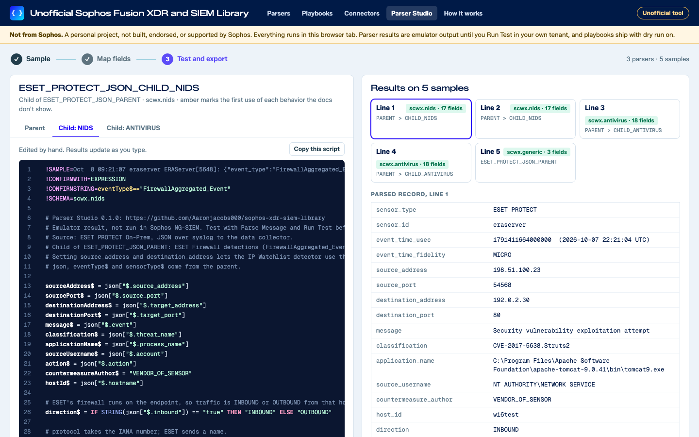

# Parser Studio for Sophos NG-SIEM

> **Unofficial project, not from Sophos.** This is a personal project by an individual. It is not an official Sophos product and it is not built, endorsed, supported, or warranted by Sophos. Raise problems as issues on this repository, not with Sophos support. Report a security problem privately, as [SECURITY.md](SECURITY.md) explains.

Parser Studio helps you write custom parsers for Sophos Next-Gen SIEM (Sophos NG-SIEM) and test them in your browser before you add them in Sophos Fusion. It also holds a community library of parsers that anyone can use, test against their own logs, fork, and add to.

Open the studio at https://aaronjacobs000.github.io/sophos-ngsiem-parser-studio/



## What it does

1. Sample: paste or drop log lines. The page finds the syslog header and the body format (JSON, CEF, LEEF, key=value, delimited or plain text), the key that splits event types, and a confirm string. It suggests a parent parser with one child per event type, or a single standalone parser.
2. Map fields: each source key gets a parser field for the schema you pick, from a dictionary of common key names and the shape of each value. You change any mapping, map source values to enum names, add fixed values, and send the rest to `event_metadata`. Plain-text logs get a capture pattern with named groups that you can edit.
3. Test and export: the page writes the scripts and runs every sample through an emulator of the parser language. You see the extractor path and the parsed record for each line, and a lint report. Edit a script and the results update. Then copy the scripts into Sophos Fusion, download a test pack, or share the parsers to the library.

The lint checks syntax and directives, documented functions and their arguments, every `$` field against the destination schema, sub-fields against their types, enum values, regex patterns that Go's RE2 engine rejects, DATETIME layouts, and confirm strings that overlap a parser in the library. Each schema page on docs.sophos.com is linked from the map step.

Mapping is rules only. There is no AI service and no backend.

## Privacy

Everything runs in the browser tab. Your samples are never uploaded and never written to browser storage. The page's content security policy only lets it fetch from `api.github.com` and `raw.githubusercontent.com`, and it only uses them to read the public library.

## The emulator and its limits

There is no public Sophos parser engine or parser API, so the emulator follows the [custom parser docs](https://docs.sophos.com/fusion/customer/help/en-us/ManageYourProducts/XDRSecOps/Integrations/CustomParsers/): statements, capture patterns, JSONPath, every documented function, parent and child routing, `SANITIZE_ALL` and `TRIM_ALL`. Where the docs are silent, it does what the Sophos engine did in a lab tenant. For example, enum fields take names in any case or numbers, sub-fields such as `fileHash$.sha1$` work, the root parser sets `sensor_type`, takes `sensor_id` and the event time from a plain BSD syslog header, and Run Test rejects a parser that reads a variable before a statement sets it, even in an IF branch that isn't taken. The lint marks the few behaviors that haven't been checked as inferred. Sophos Fusion won't save a parser with `*=` anywhere in its code, a comment or a regex included, though Run Test accepts it, so the lint flags it as an error. It saves a `!PARENT` line, which the docs use to extend a global parser, only with Set Global Parent in Parser Script turned on, so the lint warns about one.

The emulator handles the syslog header the way Run Test does: it takes a plain BSD header such as `Oct 14 01:02:03 host` off `message`. A line that starts with a `<PRI>` such as `<134>`, an RFC 5424 header or an ISO time keeps its header: `message` is the whole line, there is no `sensor_id`, and the event time is the ingest time. `eventTimeUsec$` already holds it, in microseconds and to the whole second, when the parser starts. Whether ingest takes the `<PRI>` off first hasn't been checked.

Numbers work the way the engine's do. Every number is a 64-bit float, so a whole number past 9007199254740992 rounds: `9007199254740993` is `9007199254740992`. Text that reads as a number adds to a number or `TRUE`, so `"5" + 5` is `10`, but two texts still join: `"5" + "5"` is `"55"`. A minus sign only works as part of a number such as `-5`. The engine rejects `-x`, `-(3 / 2)` and `x-1`, so write `0 - x` and put spaces around a minus: `x - 1`.

The emulator has been validated against 10 real event types.

The emulator knows the fields in the docs' schema tables, plus the few more the engine was seen to store: `event_type`, `sensor_version` and `source_address` in Antivirus, `source_address` in Management Event, and `sensor_version` and `sensor_event_id` in the generic schema. It leaves out `rule_context` in Registry, which the engine drops. The engine's schemas may have others, so a field the emulator drops with a warning may still be stored. A line with no event time gets the ingest time, which for a library entry is its `reference_time`. It also can't see the built-in parsers in your tenant, which may claim the same lines first. A built-in parent sets fields of its own on its children's events, such as `os`, `computer` and `target_host` from the Windows Snare parent, which the emulator leaves out. The engine also tries first whichever of a built-in parent's children took the latest line, so when your child and a built-in one both match, the lines before decide which one takes a line. So a parser that passes here is a tested draft: add it in Sophos Fusion under Security Operations > Integrations > Custom Parsers, add your samples, and use Parse Message and Run Test before you turn it on. Sophos does not maintain custom parsers, and this tool does not replace Sophos Professional Services, which builds custom parsers for customers.

## The community library

The library is the `parsers/` folder of this repo, one folder per vendor and product:

```
parsers/eset/eset-protect-on-prem/
  meta.json                              vendor, product, versions, format, ship method, author, license
  ESET_PROTECT_JSON_PARENT.parser.txt    one file per parser
  ESET_PROTECT_JSON_CHILD_NIDS.parser.txt
  ESET_PROTECT_JSON_CHILD_ANTIVIRUS.parser.txt
  samples.log                            synthetic sample lines
  expected.json                          the emulator's result for each line
```

The studio reads the library from GitHub each time it loads, so a parser shows up as soon as it merges, with no redeploy. If GitHub can't be reached, the page falls back to a copy built into the site, refreshed on every merge and daily. In the studio you can open any entry, run your own lines through it, or fork it as a starting point.

It has 103 entries with 255 parsers:

- Network, firewall and web: Amazon CloudFront standard logs, Amazon Route 53 Resolver query logs, Arista VeloCloud SD-WAN, AWS Network Firewall, dnsmasq, DNSFilter, DrayTek Vigor, F5 BIG-IP ASM and APM, HAProxy, HPE Aruba EdgeConnect SD-WAN, ISC DHCP and Kea, Juniper Mist, MikroTik RouterOS, nginx and Apache access logs, OpenSSH sshd, OpenVPN, Skyhigh Secure Web Gateway, Snort 3, Squid, Suricata EVE JSON, Trellix Intrusion Prevention System (McAfee NSP), Trellix Network Security (NX), Trend Micro Deep Discovery Inspector, Trend Micro TippingPoint SMS, UniFi gateway firewall logs, Vectra AI Respond UX, VMware NSX and Zscaler Private Access.
- Email: Barracuda Email Security Gateway and Email Gateway Defense, Cisco Secure Email Gateway, Exchange Server message tracking, FortiMail and Red Sift OnDMARC.
- Endpoint and application control: Airlock Digital, Bitdefender GravityZone, Carbon Black Cloud, Cisco Secure Endpoint, Cortex XDR alerts, CyberArk Endpoint Privilege Manager, ESET PROTECT On-Prem (JSON) and ESET PROTECT Cloud, Fortinet FortiEDR, Kaspersky Security Center, Linux auditd, Microsoft Sysmon, ThreatDown Nebula and OneView, ThreatLocker Detect, Trend Micro Apex Central, WatchGuard Endpoint Security, Windows PowerShell and AppLocker and WithSecure Elements.
- Identity, access and secrets: 1Password Business, Azure Key Vault, BeyondTrust Privileged Remote Access and Remote Support, Bitwarden, HashiCorp Vault, Keeper Security, NordPass Business, OneLogin, PingFederate, RSA SecurID Authentication Manager, SailPoint Identity Security Cloud and Tenable Identity Exposure.
- Cloud, DevOps and security operations: Atlassian organization audit logs, AWS Security Hub CSPM findings, Azure SQL auditing, GitHub Enterprise Cloud audit logs, GitLab audit events, Google Workspace audit logs, Kubernetes audit logs (AKS and EKS), SQL Server audit, Wazuh alerts and Zoom sign-in and operation logs.
- Backup, storage and data protection: Commvault, Druva Cloud Platform, Forcepoint DLP, Nasuni Edge Appliance, Symantec DLP and Veritas NetBackup.
- MSP tools: Autotask, Auvik, ConnectWise ScreenConnect, Datto RMM, Hudu, Huntress, IT Glue, Kaseya VSA 10 and 9.5, N-able N-central and N-sight RMM, NinjaOne, Splashtop, Syncro and TeamViewer.
- Devices and AI audit: IBM MaaS360, Microsoft Intune audit logs, OpenAI ChatGPT Enterprise compliance logs, OpenAI API Platform audit logs and the Claude Compliance API activity feed.
- Other: 3CX, Nutanix Prism Central, Synology DSM and VMware ESXi.

Every sample is synthetic. Library parsers have passed the emulator and the repo's checks, and an entry is marked tenant tested only when someone reports a passing Run Test.

## Bridges

Some sources only offer a pull API, and some push webhooks that can't add the header HTTP Ingest needs, so a parser alone can't get their logs into Sophos NG-SIEM. The `bridges/` folder holds small scripts that poll those APIs or relay those webhooks, and send each record to a Sophos NG-SIEM HTTP Ingest integration. There are bridges for the OpenAI and Anthropic enterprise compliance logs ([bridges/ai-compliance-logs](bridges/ai-compliance-logs/)), 1Password Business, Atlassian organization audit logs, Bitwarden, Cisco Secure Endpoint, CyberArk Endpoint Privilege Manager, Datto RMM, Druva Cloud Platform, ESET PROTECT Cloud (through ESET Connect), Google Workspace, IBM MaaS360, IT Glue, Kaseya VSA 10 and 9.5, N-able N-sight RMM, NordPass Business, Red Sift OnDMARC, SailPoint Identity Security Cloud, Syncro, TeamViewer, WithSecure Elements and Zoom. A webhook relay ([bridges/webhook-relay](bridges/webhook-relay/)) covers Huntress, ConnectWise ScreenConnect, Hudu, Autotask and Juniper Mist. Bridges are tested against the vendors' documented response shapes, not live services.

A library entry that needs a bridge names it in `meta.json`, for example `"bridge": "bridges/ai-compliance-logs"`. Its card in the studio shows a **needs a bridge** badge, and its page shows the bridge's README and Python script, with Copy and Download. Bridges are code that people run, so the maintainer reviews every one before it merges.

Bridges were called collectors until October 2026, when they were renamed so nobody mistakes them for the Sophos data collector. The old `"collector"` key and `COLLECTOR_*` settings still work.

## Contributing

Use **Share to the library** on the Test step. It runs the same checks as the repo, then you either open a pull request in the browser or fill in an issue form, both with your GitHub account. A workflow checks every submission. When the checks pass and the entry is new or already yours, it can merge without waiting for a person. [CONTRIBUTING.md](CONTRIBUTING.md) has the details, including how to work from a git clone.

## Run it locally

You need Node.js 22 or later. There are no packages to install.

```bash
git clone https://github.com/Aaronjacobs000/sophos-ngsiem-parser-studio.git
cd sophos-ngsiem-parser-studio
npm test                 # unit tests
npm run validate         # the library checks CI runs
npm run build            # builds the site into _site/
npm run serve            # serves _site/ on http://127.0.0.1:8080
```

The emulator also runs from the command line:

```bash
node tools/emulate.mjs --entry parsers/oisf/suricata
node tools/emulate.mjs --lint samples.log TOP.parser.txt CHILD.parser.txt
```

`npm run schemas` rebuilds the schema data from the public schema pages.

## Project layout

| Path | What it holds |
| --- | --- |
| `studio/` | The static site. `studio/core/` is the emulator, lint, detection, mapping and library code, shared by the page and the Node tools. `studio/app/` is the interface. |
| `parsers/` | The community library. |
| `bridges/` | Example bridges for pull-only sources and a relay for webhooks, each with a README and unit tests. The maintainer reviews every one. |
| `tools/` | Command-line tools and the scripts the workflows run. |
| `test/` | Unit tests (`node --test`). |
| `.github/workflows/` | CI, the library checks for pull requests, the issue-form route, and the Pages deploy. |

## License

MIT. See [LICENSE](LICENSE) and [ATTRIBUTIONS.md](ATTRIBUTIONS.md). Sophos, Sophos NG-SIEM and Sophos Fusion are names of Sophos Ltd, used here only to say what the tool works with.
